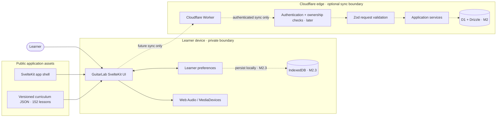
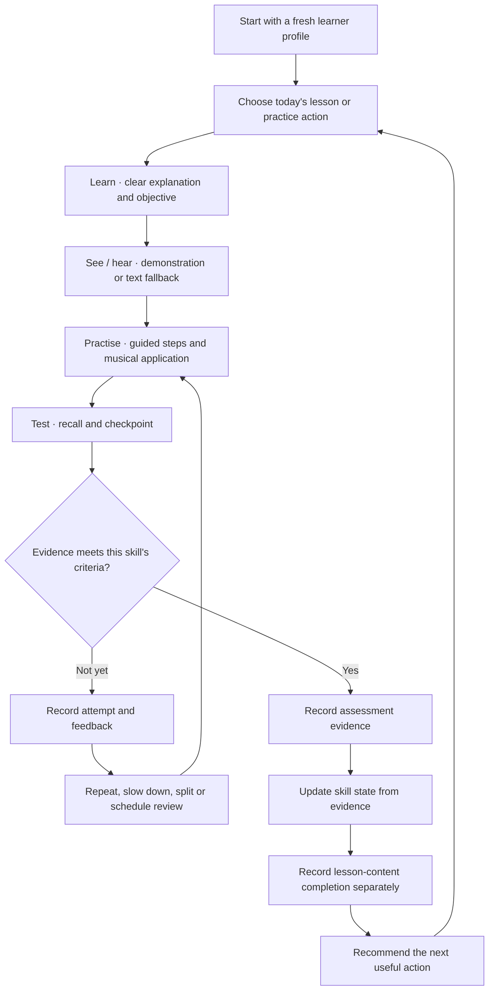
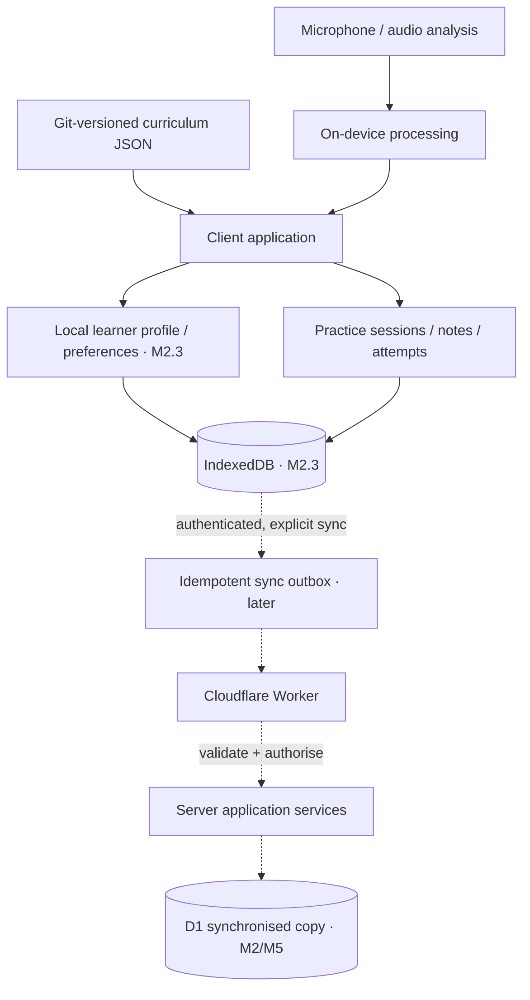
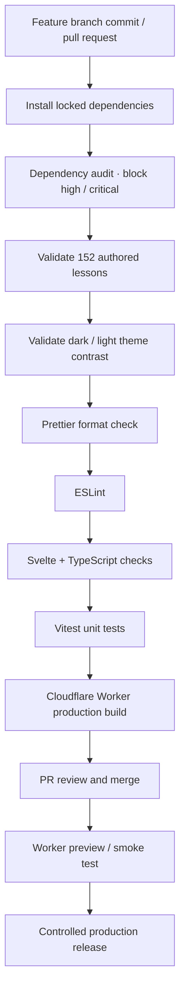
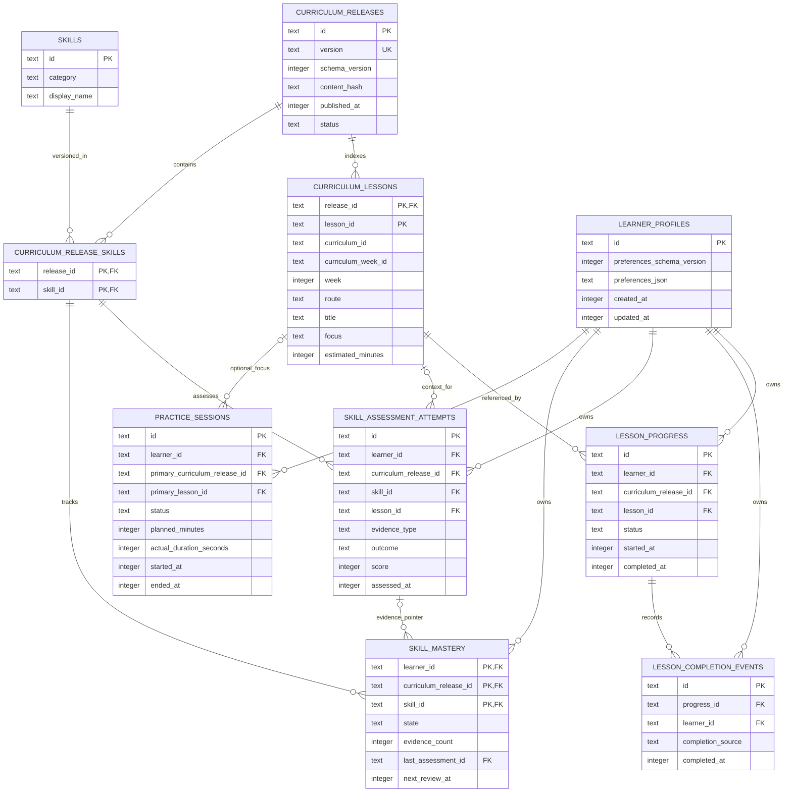
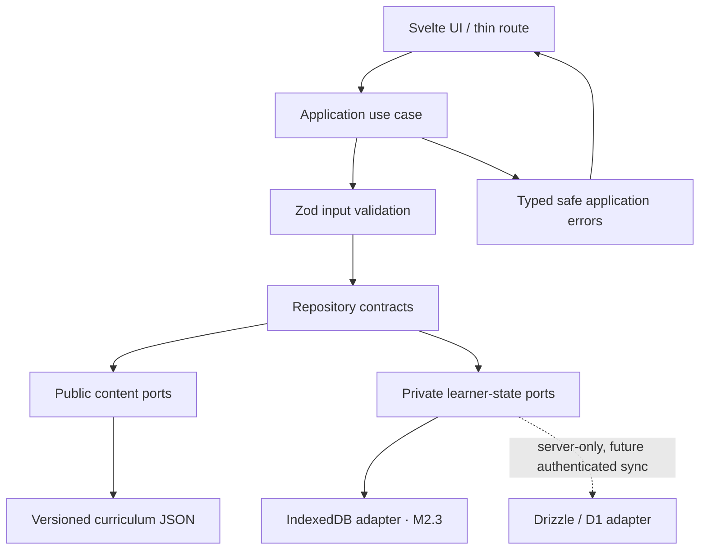

# GuitarLab System Diagrams

These diagrams describe the approved architecture and the implementation boundaries. Solid nodes/links describe the product design; dashed nodes/links indicate later milestones. The repository's authored curriculum and architecture document remain the sources of truth.

## 1. System context and trust boundaries

**Privacy rule:** public curriculum and application code may be served from the edge. Learner preferences, assessments, practice notes and recordings remain private. Local persistence is added in M5; D1 is an optional authenticated sync copy, not a requirement for local practice.

## 2. Progressive teaching and evidence loop

A lesson view, elapsed timer or completion button does not establish skill mastery. Lesson-content completion and demonstrated skill evidence are separate records. An unsuccessful checkpoint is useful feedback, not a punitive failure.

## 3. Data ownership and sync boundary

- New profiles start empty and do not import another lesson history.
- Assessments and practice events are append-only evidence.
- Cloud sync is disabled until authentication, ownership checks and conflict rules are implemented.
- Microphone processing is opt-in and local by default.

## 4. Delivery and verification pipeline

The CI gate validates the source and builds the Worker. A successful build is not itself proof of a live deployment; preview and production release remain separate verification steps.

## 5. Milestone sequence

```mermaid
flowchart LR
  M0["M0 · Product, curriculum and architecture"] --> M1["M1 · SvelteKit + Worker foundation"]
  M1 --> M2["M2.1–M2.2 · D1 / Drizzle + domain services"]
  M2 --> M23["M2.3 · Local IndexedDB profile and repositories"]
  M23 --> M24["M2.4 · Export / restore / safe reset"]
  M24 --> M3["M3 · Learning dashboard"]
  M3 --> M4["M4 · Curriculum and lesson engine"]
  M4 --> M5["M5 · Offline hardening + authenticated sync"]
  M5 --> M6["M6 · Music tools"]
  M6 --> M7["M7 · Practice studio"]
  M7 --> M8["M8 · Musicianship and repertoire"]
  M8 --> M9["M9 · Release hardening"]
```

## 6. M2.1 relational data model

The relational schema is split between immutable curriculum release metadata and learner-owned activity/evidence. Foreign-key ownership keys are shown where they enforce scope. Full lesson bodies remain in versioned JSON and are not stored in D1.

**Important distinctions:** `lesson_progress` is the current/resume state; `lesson_completion_events` is append-only completion history; `skill_assessment_attempts` is append-only evidence; `skill_mastery` is a derived snapshot that must reference a passed attempt for the same learner, release and skill. These relationships are enforced by composite foreign keys, checks and database triggers in the M2.1 migration.

## 7. M2.2 application and repository boundaries

The use cases depend on interfaces, not storage libraries. Public curriculum reads cannot access learner records. Lesson completion writes progress and its immutable event through one atomic repository operation; assessment attempts are append-only; stable mastery is recalculated from scoped evidence; practice completion is a conditional transition and never grants mastery. Concrete IndexedDB and D1 adapters remain separate milestones.
